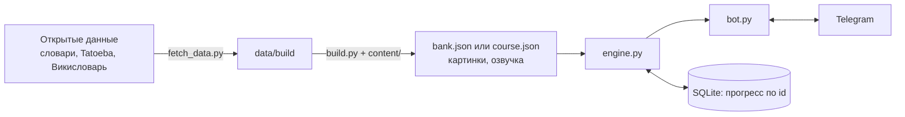

# Telegram Language Bots

[Русский](#русский) · [English](#english)

## Русский

Два независимых Telegram-бота-репетитора для изучения языков с нуля: **японского** (`japanese/`) и **тайского**
(`thai/`). Уроки по 5-10 минут, у каждого слова и фразы голос, вопросы с вариантами ответа, повторение по интервалам,
напоминания по времени и часовому поясу ученика. Интерфейс и объяснения на русском. Общий движок намеренно не выделен: это два отдельных проекта, у них свои данные, свой код и свой запуск.

### Что умеют

**Японский** (`japanese/`)

- Азбука с нуля: 24 урока (хирагана, катакана, первые фразы). У каждого знака картинка (шрифт Klee One), чтение
  русскими буквами, подсказка и голос.
- Вход за пару вопросов: «С нуля» или «Кое-что знаю». Лесенка (хирагана, катакана, кандзи N5, N4) подбирает место
  в курсе. Отдельный тест уровня из 7 частей: кана, слова, значения и чтения кандзи, даты, слух, грамматика.
- 49 уроков кандзи N5-N4 (245 знаков): значение, подсказка для запоминания, слово с кунным и слово с онным чтением,
  вопросы с возвратом ошибок в конец урока.
- 20 уроков грамматики N5 (правило, примеры, пропуски, переводы).
- Даты, время и числа: 9 уроков по шагам, потом тренажёр. Ответы и неверные варианты строятся по правилам
  (`jpnum.py`, `drills.py`), а не берутся из списка.
- Слух: 160 фраз с записями живых носителей Tatoeba (подпись диктора и лицензии) и кнопка «медленно» синтезом.
  Кана на слух: 536 слов, ловушки на долготу, `っ`, звонкость, похожие знаки.
- Повторение по интервалам (1, 2, 4, 7, 15, 30 дней), разминка из 5 карточек перед каждым уроком, прогресс, напоминание
  в нужное время (`/time`, `/tz`), кнопка «Написать» автору, статистика учеников для владельца (`/users`).

**Тайский** (`thai/`)

- 69 уроков основного пути: звуки и тоны (13), первые фразы и грамматика (32), темы про поездки, жизнь и общение (24).
  Не больше 6 новых слов в уроке.
- Алфавит по желанию (12 уроков, `/abc`).
- «Разговор»: 13 сценок (6 разговорных и 7 мест: кофейня, рынок, такси, аптека и другие) со шпаргалкой, уроком
  и диалогом по ролям.
- Тоны: вопросы «одинаковый или разный», «какой тон», четыре «диктора» (мужской и женский голос и их сдвиги на
  3 полутона через ffmpeg), опорное слово на каждый тон, тренажёр, который чаще даёт то, что ученик путает.
- У каждого слова и фразы голос, транскрипция с тонами (из Викисловаря, изменённая система Paiboon), перевод и подсказка для
  запоминания. Курс собирается в мужской (`ครับ`, `ผม`) и женский (`ค่ะ`, `ฉัน`, женский голос) вариант.
- Знакомство: речь, цель (поездка, жизнь, общение), что уже знает, проверка на слух, план и сразу первый урок.
- Повторение по интервалам, разминка перед уроком, напоминание, `/users` для владельца, кнопка «Написать».

### Как устроено

В каждом боте один и тот же порядок: `bot.py` (обёртка Telegram, меню, напоминания), `engine.py` (вся логика без
Telegram: уроки, вопросы, повторение, прогресс в SQLite), `build.py` (собирает данные для движка), `tts.py` (озвучка),
`content/` (написанные вручную тексты курса), `simulate.py` и `test_bot.py` (проверки).



Python 3.12, python-telegram-bot, edge-tts (озвучка нейроголосами Microsoft), Pillow (картинки японского), PyYAML
(курс тайского), SQLite, ffmpeg.

### Запуск японского

Нужны: Python 3.12, ffmpeg, около 1 ГБ свободной памяти на сборку, токен бота от @BotFather
и около 600 МБ на диске (после сборки словари в `data/build` боту не нужны, их можно удалить).

```bash
git clone https://github.com/olshanskiyad/telegram-language-bots.git && cd telegram-language-bots/japanese
python3.12 -m venv .venv && . .venv/bin/activate
pip install -r requirements.txt
cp .env.example .env              # вписать JP_BOT_TOKEN, по желанию OWNER_ID
set -a; . ./.env; set +a          # загрузить переменные в оболочку
python fetch_data.py              # скачать словари, списки JLPT, Tatoeba и шрифт (около 60 МБ, распакованные около 350 МБ)
python build.py                   # собрать bank.json и картинки, около 20 секунд
python build.py --audio-only      # озвучка Edge TTS: около 4600 записей, 1,5-2 часа
python fetch_native.py            # записи носителей Tatoeba: 160 штук по одной с паузой, около получаса
python bot.py
```

Озвучку и записи носителей можно сделать позже или не делать вовсе: без файла бот присылает текст без голоса,
а голос появляется, как только файл лёг в `data/audio`. `python build.py --audio` делает сборку, озвучку и записи
носителей одной командой.

Через Docker (из корня репозитория):

```bash
cp japanese/.env.example japanese/.env        # заполнить
docker compose run --rm japanese-bot sh -c "python fetch_data.py && python build.py --audio"
docker compose up -d --build japanese-bot
```

### Запуск тайского

Нужны: Python 3.12, ffmpeg (с фильтром `rubberband`, он есть в пакетах Debian и Ubuntu), токен бота, около 100 МБ на диске.

```bash
cd telegram-language-bots/thai
python3.12 -m venv .venv && . .venv/bin/activate
pip install -r requirements.txt
cp .env.example .env              # вписать THAI_BOT_TOKEN, по желанию OWNER_ID
set -a; . ./.env; set +a
python fetch_data.py              # выгрузка Викисловаря с kaikki.org, около 50 МБ
python build.py --audio           # course.json, course_f.json и озвучка: около 1500 записей, 30-60 минут
python bot.py
```

Без `--audio` курс тоже соберётся, голос добавится при следующей сборке с `--audio` (готовое не озвучивается заново).
В Docker: `docker compose run --rm thai-bot sh -c "python fetch_data.py && python build.py --audio"`, затем
`docker compose up -d --build thai-bot`.

### Настройки

Все настройки в `.env`, описание каждой переменной в `.env.example` каждого бота. Главные:

| Переменная | Что задаёт |
|---|---|
| `JP_BOT_TOKEN`, `THAI_BOT_TOKEN` | токен бота от @BotFather (обязательно) |
| `OWNER_ID` | Telegram id владельца (см. ниже) |
| `BOT_NAME` | отображаемое имя бота; пусто: имя из BotFather не меняется |
| `JP_DATA`, `THAI_DATA` | папка данных (по умолчанию `./data` рядом с кодом; в Docker `/app/data`) |
| `JP_LOG`, `THAI_LOG` | папка логов (по умолчанию `./logs`) |
| `JP_DB`, `THAI_DB` | путь к базе прогресса (по умолчанию `<папка данных>/bot.db`) |

**Владелец бота.** Владелец видит команду `/users` (дни занятий, время, пройденные уроки, ответы, результаты теста) и
получает копии сообщений, которые ученики присылают кнопкой «Написать». Если `OWNER_ID` задан, владельцем становится
только этот Telegram id (как только он напишет боту). Если не задан (по умолчанию), владельцем становится первый, кто
написал боту. Это удобно для личного бота, но для бота, доступного другим людям, лучше задать `OWNER_ID` заранее.
Свой id показывает, например, @userinfobot. Команда `/users` появляется в меню команд владельца после перезапуска бота,
работает она сразу.

**Кто может пользоваться.** Любой, кто нашёл бота и написал ему: ученики заводятся сами, прогресс хранится по Telegram id.
В базе лежат только id, ответы, время занятий, сообщения «Написать» и последний текст, присланный мимо кнопок (пока
ученик не решит, передавать ли его автору); имена бот берёт у Telegram в момент запроса
`/users` и не сохраняет. Если вы открываете бота другим людям, вы отвечаете за их данные по законам своей страны.

### Откуда данные и их лицензии

В репозитории нет словарей, предложений, шрифтов и озвучки: их скачивает `fetch_data.py` (и `fetch_native.py`),
а `build.py` собирает из них данные бота. Полный список с условиями и текстами указания источника: [NOTICE](NOTICE).

| Данные | Источник | Лицензия | Бот |
|---|---|---|---|
| JMdict, KANJIDIC2, KRADFILE: слова, чтения, русские и английские значения, кандзи, части кандзи | [EDRDG](https://www.edrdg.org/) | CC BY-SA 4.0 ([текст EDRDG](https://www.edrdg.org/edrdg/licence.html)); у не-английских переводов отдельный копирайт составителей | японский |
| Списки JLPT N5-N3 | Jonathan Waller, tanos.co.uk; CSV из репозиториев jamsinclair/open-anki-jlpt-decks и Bluskyo/JLPT_Vocabulary (MIT) | CC BY (версия не указана; сайт не отвечал 22.10.2026, [архивная копия](http://web.archive.org/web/2026/http://www.tanos.co.uk/jlpt/sharing/)) | японский |
| Фразы, переводы, чтение каной, записи носителей | [Tatoeba](https://tatoeba.org/en/downloads) | предложения CC BY 2.0 FR; записи: лицензия у каждого диктора своя, бот берёт только CC BY 4.0 и CC BY-NC 4.0 (NC: только некоммерческое использование) | японский |
| Шрифт Klee One (картинки азбуки и кандзи) | Fontworks, google/fonts | SIL OFL 1.1 | японский |
| Транскрипция (изменённый Paiboon) и значения слов | английский Викисловарь, [kaikki.org](https://kaikki.org/) | CC BY-SA 4.0 и GFDL | тайский |
| Часть фраз и диалогов в `thai/content` | [voreioai/thai-app](https://github.com/voreioai/thai-app) | MIT (`thai/content/THAI_APP_LICENSE.txt`) | тайский |
| Голоса Microsoft (Nanami, Keita, Niwat, Premwadee) | неофициальный канал читалки Edge через пакет [edge-tts](https://github.com/rany2/edge-tts) | LGPL-3.0 (пакет); условия Microsoft на синтез действуют отдельно | оба |

Тексты курсов в `content/` написаны автором (часть тайских фраз и диалогов взята из voreioai/thai-app, MIT, см. NOTICE)
и лежат под MIT вместе с кодом. Собранные данные (`bank.json`, `course.json`,
индексы) содержат материал источников, среди них с условием ShareAlike: публикуя их, соблюдайте условия из NOTICE (в частности
CC BY-SA 4.0).

### Тесты

Тесты не требуют скачанных словарей, озвучки и токена. Для CI и для быстрой проверки есть набор на тестовых данных:

```bash
cd japanese && python tests/smoke.py      # или cd thai
```

`tests/smoke.py` собирает тестовые данные во временной папке и запускает `simulate.py` (весь путь ученика по кнопкам,
ограничения Telegram) и `test_bot.py` (обработчики бота с подставным Telegram). Нужен ffmpeg. Что в тестовых данных:

- японский: `bank.json` из десятка кандзи и нескольких десятков слов, составленных вручную (без JMdict и Tatoeba); азбука
  и грамматика настоящие из `content/`;
- тайский: настоящий курс из `content/`, собранный с фиктивным словарём (транскрипции слов без подсказки в тексте курса
  выдуманы, это годится для проверки движка, но не для учёбы).

Полный прогон на настоящих данных после сборки (`fetch_data.py`, `build.py --audio`):

```bash
python simulate.py && python test_bot.py          # в папке japanese или thai
```

Оба скрипта завершаются с ненулевым кодом, если нашли проблему. На настоящих данных они дополнительно проверяют, что
у карточек есть озвучка, поэтому без `--audio` могут завершиться с ошибкой.

### Важно

- Озвучка идёт через неофициальный канал читалки Edge. Если на все фразы начнёт приходить ошибка 403, обновите пакет:
  `pip install -U edge-tts`. Готовые записи при этом не пропадают. Официальная замена с теми же голосами: Azure AI Speech.
- Записи носителей Tatoeba качаются по одной с паузой: сайт отвечает 429 на частые запросы.
- Чтобы поменять уроки, правьте файлы в `content/` (формат описан в шапках файлов) и запустите `build.py` заново.
- Словари обновляются (JMdict каждый день, выгрузка Викисловаря раз в пару недель), сборка проверена на выгрузках
  от 22.10.2026. Если `build.py` остановился на проверке, он пишет, что именно не сходится: обычно достаточно поправить
  слово или транскрипцию в `content/` (у японского ещё `RU_FIX` в `build.py`); уже скачанные файлы `fetch_data.py` не
  перекачивает, пока вы не попросите `--force`.

## English

Two independent Telegram tutor bots for learning a language from scratch: **Japanese** (`japanese/`) and **Thai**
(`thai/`). 5-10 minute lessons, a voice for every word and phrase, multiple-choice questions, spaced repetition and
reminders in the learner's own time zone. The interface and the explanations are in Russian (the learners are Russian
speakers). They deliberately do not share an engine: each one has its own data, code and setup.

### Features

**Japanese**

- Kana from scratch: 24 lessons (hiragana, katakana, first phrases). Every character has a picture (Klee One font), a
  reading in Cyrillic, a mnemonic and a voice.
- A short entry ladder (hiragana, katakana, kanji N5, N4) places you in the course; a separate 7-part level test
  (kana, words, kanji meanings and readings, dates, listening, grammar).
- 49 kanji lessons N5-N4 (245 kanji): meaning, mnemonic, one word with the kun reading and one with the on reading,
  mistakes come back at the end of the lesson. 20 N5 grammar lessons.
- Dates, time and numbers: 9 step-by-step lessons, then a drill. Answers and wrong options are generated by rules
  (`jpnum.py`, `drills.py`).
- Listening: 160 phrases with recordings of native speakers from Tatoeba (the speaker and the licence are shown) and a
  "slow" button; kana by ear.
- Spaced repetition, a 5-card warm-up before every lesson, progress, reminders (`/time`, `/tz`), a "write to the author"
  button, learner statistics for the owner (`/users`).

**Thai**

- 69 lessons: sounds and tones (13), first phrases and grammar (32), topics for travel, life and small talk (24).
  At most 6 new words per lesson. Optional alphabet (12 lessons, `/abc`).
- "Conversation": 13 scenes (6 talk scenes and 7 places such as a cafe, a market, a taxi, a pharmacy).
- Tones: same/different and which-tone questions, four "speakers" (male and female voice plus pitch-shifted copies via
  ffmpeg), an anchor word per tone, a trainer that serves the tones you confuse most.
- Every word and phrase has a voice, a transcription with tones (a modified Paiboon system, from Wiktionary), a translation and a
  mnemonic. The course is built in a male (`ครับ`, `ผม`) and a female (`ค่ะ`, `ฉัน`, female voice) variant.
- Onboarding (speech, goal, what you know, listening check, plan), spaced repetition, reminders, `/users`.

### How it works

In each bot: `bot.py` (Telegram wrapper), `engine.py` (all the logic without Telegram, progress in SQLite),
`build.py` (builds the data for the engine), `tts.py` (speech), `content/` (hand-written course texts),
`simulate.py` and `test_bot.py` (checks). Python 3.12, python-telegram-bot, edge-tts, Pillow (Japanese), PyYAML (Thai),
SQLite, ffmpeg.

### Run the Japanese bot

You need Python 3.12, ffmpeg, about 1 GB of free memory for the build, a bot token from
@BotFather and about 600 MB of disk (the dictionaries in `data/build` are not needed by the bot after the build).

```bash
git clone https://github.com/olshanskiyad/telegram-language-bots.git && cd telegram-language-bots/japanese
python3.12 -m venv .venv && . .venv/bin/activate
pip install -r requirements.txt
cp .env.example .env              # set JP_BOT_TOKEN, optionally OWNER_ID
set -a; . ./.env; set +a          # export the variables
python fetch_data.py              # dictionaries, JLPT lists, Tatoeba, font (about 60 MB, about 350 MB unpacked)
python build.py                   # bank.json and images, about 20 seconds
python build.py --audio-only      # Edge TTS voices: about 4600 files, 1.5-2 hours
python fetch_native.py            # Tatoeba native recordings: 160 files, one by one with a pause, about 30 minutes
python bot.py
```

Audio is optional and can be added later: without a file the bot sends the text without a voice, and the voice
appears as soon as the file is in `data/audio`. Docker, from the repository root:

```bash
cp japanese/.env.example japanese/.env
docker compose run --rm japanese-bot sh -c "python fetch_data.py && python build.py --audio"
docker compose up -d --build japanese-bot
```

### Run the Thai bot

You need Python 3.12, ffmpeg with the `rubberband` filter (Debian and Ubuntu packages have it), a bot token, about 100 MB.

```bash
cd telegram-language-bots/thai
python3.12 -m venv .venv && . .venv/bin/activate
pip install -r requirements.txt
cp .env.example .env              # set THAI_BOT_TOKEN, optionally OWNER_ID
set -a; . ./.env; set +a
python fetch_data.py              # Wiktionary dump from kaikki.org, about 50 MB
python build.py --audio           # course.json, course_f.json and the voices: about 1500 files, 30-60 minutes
python bot.py
```

Docker: `docker compose run --rm thai-bot sh -c "python fetch_data.py && python build.py --audio"`, then
`docker compose up -d --build thai-bot`.

### Settings and the bot owner

Every variable is described in `.env.example` of each bot (token, `OWNER_ID`, `BOT_NAME`, data and log folders
`JP_DATA`/`THAI_DATA` and `JP_LOG`/`THAI_LOG`, database path). By default the folders are `./data` and `./logs` next to
the code (`/app/data` and `/app/logs` in Docker).

The owner sees `/users` (study days, time, finished lessons, answers, test results) and gets copies of the messages
learners send with the "write" button. If `OWNER_ID` is set, only that Telegram id becomes the owner (once it writes to
the bot). If it is not set (the default), the **first person who writes to the bot becomes the owner**. That is
convenient for a personal bot, but if other people can reach your bot, set `OWNER_ID` in advance (for example @userinfobot
shows your id). Anyone who writes to the bot becomes a learner; the database stores only ids, answers, study time,
the feedback messages and the last text sent outside the buttons (until the learner decides whether to pass it on),
never names. If you open the bot to other people, you are responsible for their data under the
law of your country.

### Data sources and licenses

The repository contains no dictionaries, sentences, fonts or audio: `fetch_data.py` (and `fetch_native.py`) download
them and `build.py` builds the bot data from them. The full list with the terms and acknowledgements is in
[NOTICE](NOTICE). In short:

- JMdict, KANJIDIC2, KRADFILE (EDRDG): CC BY-SA 4.0; the non-English translations in JMdict have a separate copyright
  of their compilers.
- JLPT lists N5-N3 (Jonathan Waller, via two MIT repositories): CC BY (version not stated).
- Tatoeba: sentences CC BY 2.0 FR; recordings under each speaker's licence, the bot uses only CC BY 4.0 and CC BY-NC 4.0
  (NC: non-commercial use only).
- Klee One font: SIL OFL 1.1.
- Wiktionary through kaikki.org (Thai transcription): CC BY-SA 4.0 and GFDL.
- Phrases from voreioai/thai-app: MIT (`thai/content/THAI_APP_LICENSE.txt`).
- Voices: Microsoft neural voices through the unofficial Edge read-aloud channel (edge-tts, LGPL-3.0); Microsoft's terms
  for synthesized speech apply separately.

The course texts in `content/` are written by the author (some Thai phrases and dialogues come from voreioai/thai-app,
MIT, see NOTICE) and are MIT like the code. The built data files contain
material from the sources, some of it ShareAlike: if you publish them, follow the terms in NOTICE (notably CC BY-SA 4.0).

### Tests

Tests need no dictionaries, audio or token. For CI and a quick check there is a suite on test data:

```bash
cd japanese && python tests/smoke.py      # or: cd thai
```

`tests/smoke.py` builds test data in a temporary folder and runs `simulate.py` (a full learner path through the
buttons, Telegram limits) and `test_bot.py` (the bot handlers against a fake Telegram). ffmpeg is required. Japanese test
data is a hand-written `bank.json` of about ten kanji and a few dozen words (kana and grammar content is real); Thai
test data is the real course built with a fake dictionary (transcriptions of words without a hint in the course text are
invented, fine for checking the engine, not for learning).

Full run on real data after `fetch_data.py` and `build.py --audio`:

```bash
python simulate.py && python test_bot.py          # in japanese/ or thai/
```

Both scripts exit with a non-zero code when they find a problem. On real data they also check that cards have audio,
so without `--audio` they may fail.

### Notes

- The voices come from an unofficial Edge channel. If every phrase starts failing with 403, upgrade the package:
  `pip install -U edge-tts`; finished recordings are kept. The official replacement with the same voices is Azure AI Speech.
- Tatoeba answers 429 to frequent requests, so the recordings are downloaded one by one with a pause.
- To change the lessons edit the files in `content/` (the formats are described in the file headers) and run `build.py` again.
- The dictionaries keep changing (JMdict daily, the Wiktionary dump every couple of weeks); the build was checked against
  the dumps of 2026-10-22. If `build.py` stops on a check it says what does not match: usually a word or a transcription
  in `content/` needs a fix (for Japanese also `RU_FIX` in `build.py`); `fetch_data.py` does not re-download files that are
  already there unless you pass `--force`.

## License

MIT, see [LICENSE](LICENSE). Third-party data and packages: [NOTICE](NOTICE). Author: Andrey Olshanskiy.
